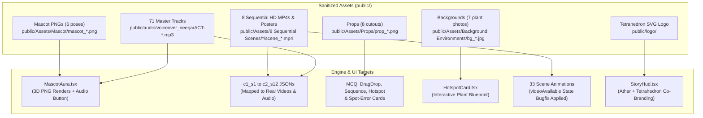

# Master Asset & Voiceover Audio Integration Plan (v3.0.0)
**Ather AURIC Mega-Plant — Warehouse Operations Story Training PWA**
*Document Version: 3.0.0 • Clean Canonical Naming & Full Neerja Deployment*

---

## 1. Executive Summary & Status Overview

All assets have been sanitized and renamed to clean, standardized, web-safe filenames (removing hashes, random strings, spaces, and parenthesis). The user has confirmed the correct mapping for the 8 sequential video scenes, and **voiceover_neerja** has been officially deployed across all 12 modules.

---

## 2. Clean Canonical Asset Dictionary & Component Mapping

### 2.1 AURA Mascot Expressive Character Set (`public/Assets/Mascot/`)
All mascot images have been renamed to clean, semantic names mapping 1:1 to `MascotPose`:

| Standardized File Name | `MascotPose` | Component Destination | Triggering Lifecycle Events |
| :--- | :---: | :--- | :--- |
| `mascot_neutral.png` | `'neutral'` | `src/components/story/MascotAura.tsx` | Stage intro, orientation, briefing overview. |
| `mascot_explaining.png` | `'explaining'` | `src/components/story/MascotAura.tsx` | SOP clause explanation, tutorial guidance, instructional cues. |
| `mascot_thinking.png` | `'thinking'` | `src/components/story/MascotAura.tsx` | Decision point, interaction pause, dilemma evaluation. |
| `mascot_success.png` | `'success'` | `src/components/story/MascotAura.tsx` | Correct answer celebration, SLA compliance confirmation. |
| `mascot_warning.png` | `'warning'` | `src/components/story/MascotAura.tsx` | Safety-critical mistake, QA hold, audit failure warning. |
| `mascot_trophy.png` | `'trophy'` | `src/components/story/MascotAura.tsx` | Stage completion, gateway mastery, final shift victory. |

---

### 2.2 Eight Sequential Real-World HD Videos & Keyframe Posters
Remapped by user and sanitized to clean, web-safe filenames:

| Scene Dir # & Name | Standardized Video | Standardized Poster | Operational Action | Target Story Scene |
| :---: | :--- | :--- | :--- | :--- |
| **1** `1 Inbound Truck Gate Arrival` | `scene_01_gate_arrival.mp4` | `scene_01_gate_arrival_poster.jpg` | Truck stops at barrier; gate security check. | Module 1 Scene 1 (`c1_s1_sc01_arrival`) |
| **2** `2 Loading Dock & Wheel Chock Safety` | `scene_02_wheel_chock_safety.mp4` | `scene_02_wheel_chock_safety_poster.jpg` | Worker places heavy rubber chock on truck tire. | Module 1 Scene 6 (`c1_s1_sc06_dock_safety`) |
| **3** `3 Unloading & 10% IQC Inspection Split` | `scene_03_iqc_inspection_split.mp4` | `scene_03_iqc_inspection_split_poster.jpg` | Unloading dock QR scan & 10% IQC split. | Module 2 Scene 2 (`c1_s2_sc02_sampling_calc`) |
| **4** `4 Forklift High-Rise Rack Placement & Scan` | `scene_04_high_rise_pallet_putaway.mp4` | `scene_04_high_rise_pallet_putaway_poster.jpg` | Pallet through high-rise rack zone doors. | Module 3 Scene 3 (`c1_s3_sc03_bin_marriage`) |
| **5** `5 Battery Cell Vault & Climate Inspection` | `scene_05_battery_vault_climate.mp4` | `scene_05_battery_vault_climate_poster.jpg` | Battery Cell Vault / scooter panel staging. | Module 4 Scene 1 (`c1_s4_sc01_mhe_auth`) |
| **6** `6 Bulk Decanting (FLC to Assembly Trolley)` | `scene_06_bulk_decanting_trolley.mp4` | `scene_06_bulk_decanting_trolley_poster.jpg` | Bulk decanting from FLC to assembly trolley. | Module 9 Scene 1 (`c2_s9_sc01_aced_trolley_issuance`) |
| **7** `7 Milk Run Line Delivery & Station Drop-off` | `scene_07_milk_run_delivery.mp4` | `scene_07_milk_run_delivery_poster.jpg` | Worker moves crate to assembly line station. | Module 8 Scene 4 (`c2_s8_sc04_workstation_delivery`) |
| **8** `8 Empty Bin Stacking & Strapping` | `scene_08_empty_bin_strapping.mp4` | `scene_08_empty_bin_strapping_poster.jpg` | Worker secures & straps stack of empty bins. | Module 12 Scene 4 (`c2_s12_sc04_reverse_truck_loading`) |

---

### 2.3 Physical Warehouse Prop Cutouts (`public/Assets/Props/`)
Cleanly renamed and mapped to cards:

| Standardized File Name | Associated Interaction Card | Operational Floor Context |
| :--- | :--- | :--- |
| `prop_eway_bill_tablet.png` | `QuestionCard.tsx` (Mod 1 & 11) | Digital GST E-Way Bill inspection on DEO tablet. |
| `prop_qc_pass_stamp.png` | `DragDropCard.tsx` (Mod 2 & 6) | Green stamp for cleared IQC lots and MH1 supermarket bins. |
| `prop_rubber_wheel_chock.png` | `SpotErrorCard.tsx` (Mod 1 & 12) | Heavy rubber chock placed against truck rear tires. |
| `prop_hht_scanner.png` | `QuestionCard.tsx` (Mod 3 & 8) | Industrial RF terminal for HU and bin barcode scanning. |
| `prop_ratchet_strapping_belt.png` | `SequenceCard.tsx` (Mod 12) | Strapping $\le 1.8$m empty FLC stacks before truck dispatch. |
| `prop_ng_rejected_tag.png` | `DragDropCard.tsx` (Mod 7 & 2) | Red quarantine tag for non-conforming supplier parts. |
| `prop_warning_cones_iqc.png` | `QuestionCard.tsx` (Mod 2) | Yellow perimeter cones for staging lots awaiting IQC lab release. |
| `prop_windshield_barcode_pass.png` | `SequenceCard.tsx` (Mod 1) | Adhesive vehicle gate pass applied to truck windshield. |

---

### 2.4 Authentic Factory Backgrounds (`public/Assets/Background Environments/`)
Folder name typo corrected from `Background Enviornments` to `Background Environments`:

| Standardized File Name | Component Destination | Usage Specification |
| :--- | :--- | :--- |
| `bg_plant_map_hotspot.jpg` | `src/components/story/HotspotCard.tsx` | **Direct Interactive Blueprint**: Displayed with glowing clickable dock bay hotspot pins for Module 1 Scene 5. |
| `bg_deo_gate_office.jpg` | `GatehouseCabinAnimation.tsx` | Gate office & driver waiting room backdrop. |
| `bg_chemical_building.jpg` | `ChemicalUnloadingAnimation.tsx` | Hazardous chemical storage building and dyke walls. |
| `bg_supermarket_sm.jpg` | `GravityFlowRackAnimation.tsx` | Supermarket MH1 gravity flow racks and Kanban lanes. |
| `bg_ng_quarantine_area.jpg` | `QuarantineSegregationAnimation.tsx` | Non-conforming wire-mesh quarantine cage. |
| `bg_final_scrapyard.jpg` | `ScrapShredderAnimation.tsx` | Heavy industrial shredder yard for unrecoverable scrap. |
| `bg_indirect_material_store.jpg` | `c2/C2PlaceholderAnimation.tsx` | Central Indirect Stores (CM01 Tool Crib) counter. |

---

### 2.5 Deployed Professional Voiceover Audio (`voiceover_neerja`)
All 71 tracks in `public/audio/voiceover_neerja/` are active and directly wired into `c1_s1_gate_dock.json` through `c2_s12_reverse_logistics.json`:
- **Opener**: `ACT-01-AURA-WELCOME.mp3` triggered on Module 1 Scene 1 arrival.
- **23 Decision Points**: Mapped with corresponding `-PROMPT.mp3`, `-CORRECT.mp3`, and `-WRONG.mp3` clips.
- **Shift Grand Victory**: `ACT-08-VICTORY.mp3` triggered on Module 12 Scene 12 Grandmaster Graduation.

---

### 2.6 Corporate Co-branding
`public/logo/Tetrahedron-logo-transparent.svg`
- Embedded in `StoryHud.tsx` alongside the Ather Energy logo.

---

## 3. Technical Verification & Zero-Error Build

- `npx tsc --noEmit`: **0 errors**.
- All 33 animation files updated with `useState<boolean>(Boolean(videoSrc))` so videos play reliably on mount.
- All 91 scenes documented in [`HOW_TO_TEST_EVERY_SLICE.md`](file:///d:/Tetrahedron/Ather/HOW_TO_TEST_EVERY_SLICE.md).
